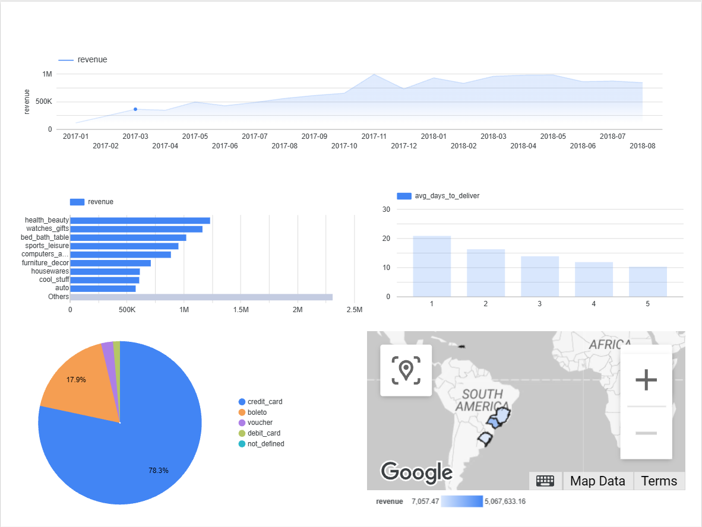

# Olist Sales Analysis

I analyzed about 100k orders from Olist, a Brazilian online marketplace, using SQL in BigQuery and built a dashboard in Looker Studio. The goal was to answer basic business questions: how sales grew, what sold, how people paid, where customers live, and whether slow delivery hurts reviews.

**Dashboard:** https://datastudio.google.com/reporting/9c437cd5-aea3-4dbe-8b93-f4ad64437aea



## Data

The public [Olist Brazilian E-Commerce dataset](https://www.kaggle.com/datasets/olistbr/brazilian-ecommerce) from Kaggle. It has 9 linked tables (orders, items, payments, reviews, customers, products, sellers, geolocation, and category translations) covering Sep 2016 to Oct 2018. This is public data, not from any employer.

## Tools

BigQuery (SQL), Looker Studio

## Setup

1. Loaded the 9 CSVs into a BigQuery dataset.
2. Checked row counts, date range, order status, and nulls (`sql/01_exploration.sql`).
3. Wrote one query per business question (`sql/02_business_questions.sql`).
4. Connected each query to Looker Studio as a custom query and built the charts.

Data cleaning notes:
- The `order_reviews` file needed "Quoted newlines" turned on because some comments have line breaks.
- Only delivered orders (97% of all orders) are used for revenue and delivery analysis.
- 610 products have no category and are grouped as "unknown."
- Trend charts cover Jan 2017 to Aug 2018. The months before and after have only a handful of orders.

## What I found

**1. Revenue grew fast through 2017, then leveled off.**
Monthly revenue went from about 112k in Jan 2017 to about 950k by early 2018, then stayed roughly flat. Nov 2017 peaked at about 988k, most likely because of Black Friday. Average order value stayed between about 125 and 150 the whole time, so growth came from more orders, not bigger ones.

**2. A few categories make most of the money.**
`health_beauty` is the top category by revenue (1.23M). `watches_gifts` is second (1.17M) with far fewer orders than `bed_bath_table`, which means its items cost more.

**3. Slow delivery goes with bad reviews.**
1-star orders took about 21 days to arrive on average. 5-star orders took about 10. Even the 1-star orders arrived a few days before the estimated date on average, so how long customers wait seems to matter more than whether the order beat the estimate.

**4. Most customers pay by credit card.**
Credit cards are about 78% of payment value and average 3.5 installments. Boleto (a Brazilian bank slip) is second.

**5. Sales are concentrated in the southeast.**
São Paulo alone is about 38% of revenue. São Paulo, Rio de Janeiro, and Minas Gerais together are about 63%. The northern states are under 1% combined.

## Ideas for next steps

- Break down late deliveries by seller and state to see where the delays come from.
- Look at repeat customers.
- Compare freight cost to product price by category.

## Repo layout

```
olist-sales-analysis/
├── data/         # raw CSVs (not in the repo, too big)
├── sql/          # 01_exploration.sql, 02_business_questions.sql
├── notebooks/
└── dashboard/    # screenshot
```

Raw data is not included. Download it from Kaggle using the link above.
